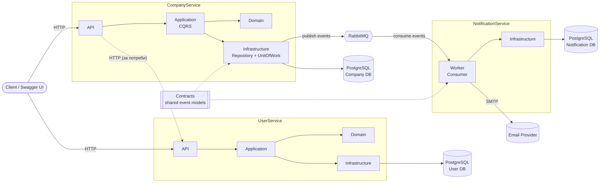
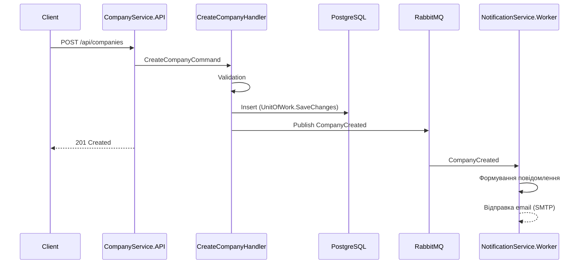

# Microservices Platform (CompanyService · UserService · NotificationService)

Розподілена система на .NET з шаровою архітектурою (API → Application → Domain → Infrastructure), CQRS, PostgreSQL та асинхронною взаємодією через RabbitMQ (MassTransit).

---

## Зміст

1. [Структура рішення](#1-структура-рішення)
2. [Детермінований запуск системи](#2-детермінований-запуск-системи)
3. [Архітектура](#3-архітектура)
4. [Опис API](#4-опис-api)
5. [Розподіл відповідальності](#5-розподіл-відповідальності)
6. [Аналіз вузьких місць (Bottleneck Analysis)](#6-аналіз-вузьких-місць-bottleneck-analysis)

---

## 1. Структура рішення

```text
├── Contracts/                      # Спільні контракти подій (CompanyCreated тощо)
│
├── CompanyService.API              # HTTP-ендпоінти, DI, Swagger
├── CompanyService.Application      # CQRS: Commands, Queries, DTOs, Mappings, Validators
│   ├── Commands/ (CreateCompany, UpdateCompany, DeleteCompany)
│   ├── Queries/
│   ├── DTOs/  Mappings/  Validators/
├── CompanyService.Domain           # Entities (Company), Interfaces (ICompanyRepository)
├── CompanyService.Infrastructure   # EF Core DbContext, Migrations, CompanyRepository,
│                                   # UnitOfWork, MassTransit/RabbitMQ (CollectionExtensionsService)
│
├── UserService.API
├── UserService.Application
├── UserService.Domain
├── UserService.Infrastructure
│
├── NotificationService.Domain
├── NotificationService.Infrastructure   # NotificationDbContext, EmailSettings (DTOs)
└── NotificationService.Worker           # Background worker: споживання подій, відправка email
```

**Стек:** .NET (`TODO: версія`), ASP.NET Core Web API, EF Core + Npgsql (PostgreSQL), MassTransit + RabbitMQ, FluentValidation (`TODO: підтвердити`), Docker / Docker Compose.

---

## 2. Детермінований запуск системи

Мета: на чистій машині отримати однаковий результат за однакових кроків — без ручного втручання в БД чи брокер.

### 2.1. Передумови

| Інструмент | Версія |
|---|---|
| Docker Engine | ≥ 24.x |
| Docker Compose | v2 (`docker compose`) |
| .NET SDK (лише для локальної розробки без Docker) | `TODO` |
| Git | будь-яка актуальна |

### 2.2. Запуск у Docker (рекомендовано)

```bash
# 1. Клонування
git clone <URL_РЕПОЗИТОРІЮ>
cd <ПАПКА_РЕПОЗИТОРІЮ>

# 2. (за потреби) змінні оточення
cp .env.example .env        # TODO: створити .env.example

# 3. Чиста збірка та запуск
docker compose down -v      # гарантує чистий стан (видаляє томи)
docker compose build --no-cache
docker compose up -d

# 4. Перевірка стану
docker compose ps
docker compose logs -f
```

### 2.3. Порядок старту та гарантії детермінованості

1. **PostgreSQL** — піднімається першим (healthcheck `pg_isready`).
2. **RabbitMQ** — хост у коді `rabbitmq`, `guest/guest` (лише для розробки!). Management UI: `http://localhost:15672`.
3. **CompanyService.API / UserService.API** — стартують після готовності БД і брокера (`depends_on` з `condition: service_healthy`).
4. **NotificationService.Worker** — при старті **автоматично застосовує міграції** (`db.Database.Migrate()`) з **retry-циклом: до 10 спроб з інтервалом 3 с**, тому порядок старту з БД не критичний.

> Імена сервісів у `docker-compose.yml` мають збігатися з тими, що використані в конфігурації: хост брокера — `rabbitmq`, рядок підключення — `ConnectionStrings:PostgreSQLConnection`.

### 2.4. Конфігурація

| Параметр | Де | Приклад |
|---|---|---|
| `ConnectionStrings:PostgreSQLConnection` | API / Worker | `Host=postgres;Port=5432;Database=<db>;Username=<u>;Password=<p>` |
| `EmailSettings` (SMTP host, port, user, password, from) | `NotificationService.Worker` | секція `EmailSettings` в `appsettings.json` |
| RabbitMQ host / user / password | `CollectionExtensionsService.AddInfrastructure` | `rabbitmq` / `guest` / `guest` |

### 2.5. Порти (TODO: підставити свої)

| Сервіс | URL |
|---|---|
| CompanyService.API | `http://localhost:5001` |
| UserService.API | `http://localhost:5002` |
| RabbitMQ Management | `http://localhost:15672` |
| PostgreSQL | `localhost:5432` |

### 2.6. Локальний запуск без Docker (альтернатива)

```bash
# Інфраструктура
docker compose up -d postgres rabbitmq

# Міграції (для CompanyService)
dotnet ef database update \
  --project CompanyService.Infrastructure \
  --startup-project CompanyService.API

# Запуск сервісів (в окремих терміналах)
dotnet run --project CompanyService.API
dotnet run --project UserService.API
dotnet run --project NotificationService.Worker
```

### 2.7. Зупинка

```bash
docker compose down        # зупинка
docker compose down -v     # зупинка + видалення даних
```

---

## 3. Архітектура

### 3.1. Загальна схема



### 3.2. Шари всередині сервісу

| Шар | Відповідальність | Залежить від |
|---|---|---|
| **API** | Контролери/ендпоінти, авторизація, Swagger | Application |
| **Application** | Commands / Queries (CQRS), Validators, DTOs, Mappings | Domain |
| **Domain** | Сутності (`Company`), інтерфейси (`ICompanyRepository`) | — |
| **Infrastructure** | EF Core `CompanyDbContext`, `CompanyRepository`, `UnitOfWork`, MassTransit | Domain |

Принцип залежностей: **Domain не залежить ні від чого**; Infrastructure реалізує інтерфейси Domain.

### 3.3. Потік «створення компанії»



---

## 4. Опис API

Повна інтерактивна специфікація (OpenAPI/Swagger):

| Сервіс | Swagger UI | OpenAPI JSON |
|---|---|---|
| CompanyService | `http://localhost:5001/swagger` | `http://localhost:5001/swagger/v1/swagger.json` |
| UserService | `http://localhost:5002/swagger` | `http://localhost:5002/swagger/v1/swagger.json` |

### 4.1. CompanyService (узгодити з реальними маршрутами — TODO)

| Метод | Маршрут | Операція | CQRS |
|---|---|---|---|
| `POST` | `/api/companies` | Створення компанії | Command: `CreateCompany` |
| `PUT` | `/api/companies/{id}` | Оновлення компанії | Command: `UpdateCompany` |
| `DELETE` | `/api/companies/{id}` | Видалення компанії | Command: `DeleteCompany` |
| `GET` | `/api/companies/{id}` | Отримання компанії за Id | Query |
| `GET` | `/api/companies` | Список компаній (пагінація) | Query |

**Коди відповідей:** `200/201/204` — успіх, `400` — помилка валідації, `404` — не знайдено, `409` — конфлікт конкурентності, `500` — внутрішня помилка.

### 4.2. UserService

`TODO: перелік ендпоінтів (реєстрація, отримання користувача, оновлення профілю тощо).`

### 4.3. Асинхронні контракти (RabbitMQ)

| Подія | Видавець | Споживач | Призначення |
|---|---|---|---|
| `CompanyCreated` (`Contracts`) | CompanyService | NotificationService.Worker | Сповіщення про створення компанії |
| `TODO` | | | |

---

## 5. Розподіл відповідальності

### 5.1. Модулі за учасниками (TODO: підставити імена)

| Учасник | Модулі / відповідальність |
|---|---|
| **Учасник 1** | `CompanyService.API`, `CompanyService.Application` (Commands/Queries/Validators) |
| **Учасник 2** | `CompanyService.Domain`, `CompanyService.Infrastructure` (DbContext, Repository, UnitOfWork, міграції) |
| **Учасник 3** | `UserService.*` |
| **Учасник 4** | `NotificationService.*`, `Contracts`, інтеграція RabbitMQ/MassTransit |
| **Усі / по черзі** | Docker Compose, CI, документація, Bottleneck Analysis |

### 5.2. RACI-матриця

R — Responsible · A — Accountable · C — Consulted · I — Informed

| Завдання | Учасник 1 | Учасник 2 | Учасник 3 | Учасник 4 |
|---|:-:|:-:|:-:|:-:|
| Проєктування архітектури | C | C | C | **A/R** |
| CompanyService (API + Application) | **A/R** | C | I | I |
| CompanyService (Domain + Infrastructure) | C | **A/R** | I | I |
| UserService | I | C | **A/R** | I |
| NotificationService + Worker | I | I | C | **A/R** |
| Контракти подій (`Contracts`) | C | C | C | **A/R** |
| Docker / запуск системи | R | R | R | **A** |
| Bottleneck Analysis | R | **A/R** | R | R |
| README / документація | **A/R** | C | C | C |

---

## 6. Аналіз вузьких місць (Bottleneck Analysis)

Теоретичний аналіз на основі спроєктованої архітектури. Визначено 5 потенційних точок деградації під високим навантаженням.

### 6.1. Читальні запити `Queries` → `CompanyRepository`

**Компонент / Операція / Запит:** `GetCompanies` / `GetCompanyById` → `ICompanyRepository` → `CompanyRepository` → таблиця `Companies` (PostgreSQL через EF Core).

**Причина (Root Cause):**
- Відсутність індексів на полях пошуку/фільтрації (`Name`, `OwnerId`, `CreatedAt`, `IsDeleted`) → Full Table Scan.
- Пагінація `Skip/Take` (OFFSET) деградує лінійно зі зростанням зсуву.
- Відсутній `AsNoTracking()` для read-запитів → зайве навантаження Change Tracker (CPU, пам'ять).
- `Include` без проєкції в DTO → over-fetching; ризик N+1 problem (lazy loading).
- Відсутнє кешування повторюваних запитів.

**Симптоматика та прояв:**
- Зростання p99 latency (з десятків мс до секунд) при збільшенні таблиці та глибини сторінки.
- Падіння Throughput/RPS при паралельних запитах; високий Disk I/O Wait на БД.
- Зростання Gen 2 GC-пауз та пам'яті в API.
- У логах EF Core — багато однотипних SQL за один HTTP-запит (N+1).

### 6.2. Вичерпання пулу з'єднань: `DbContext` / `UnitOfWork`

**Компонент / Операція / Запит:** `UnitOfWork` + `CompanyDbContext` (`AddDbContext` + `UseNpgsql`); команди `CreateCompany`, `UpdateCompany`, `DeleteCompany`.

**Причина (Root Cause):**
- Обмежений пул з'єднань Npgsql (за замовчуванням `Maximum Pool Size = 100`); з'єднання утримується до завершення `SaveChangesAsync` / commit.
- Довгі транзакції: валідація з запитами до БД, бізнес-логіка, публікація в RabbitMQ та виклики інших сервісів у межах однієї операції.
- Змішування sync/async (`.Result`, `.Wait()`) → Thread Pool Starvation.
- `AddDbContext` без `AddDbContextPool` → накладні витрати на створення контексту на кожен запит.

**Симптоматика та прояв:**
- Помилки `Timeout expired ... obtaining a connection from the pool`.
- Різке зростання p99 latency при слабкому зростанні середнього часу відповіді.
- RPS виходить на плато, а потім різко падає (черга на отримання з'єднання).
- Зростання *ThreadPool Queue Length* (`dotnet-counters`), затримки Kestrel.

### 6.3. Конкурентне оновлення `Company` (Lock Contention / Lost Update)

**Компонент / Операція / Запит:** `UpdateCompanyCommand` та `DeleteCompanyCommand` над одним записом у `Companies`.

**Причина (Root Cause):**
- Row-level блокування: паралельні транзакції над одним рядком чекають одна одну (Lock Contention).
- Відсутній optimistic concurrency token (`xmin` / `RowVersion`) → Lost Update.
- Високі рівні ізоляції (`Serializable`, `RepeatableRead`) підвищують ймовірність deadlock.
- Недетермінований порядок оновлення таблиць у `UnitOfWork`.

**Симптоматика та прояв:**
- Стрибки p99 latency на write-операціях за прийнятного середнього значення.
- `Deadlock detected`, `DbUpdateConcurrencyException`; зростання частки HTTP 409/500.
- Зниження write-throughput при збільшенні клієнтів на «гарячий рядок».
- Накопичення сесій у стані `waiting` (`pg_stat_activity`).

### 6.4. Синхронна міжсервісна взаємодія CompanyService ↔ UserService

**Компонент / Операція / Запит:** HTTP-виклики з `CompanyService.Application` до `UserService.API` (перевірка власника компанії, збагачення відповіді даними користувачів).

**Причина (Root Cause):**
- Temporal coupling: латентність = власна + UserService + мережевий RTT.
- Відсутні Timeout, Retry з backoff, Circuit Breaker (Polly) → Cascading Failure.
- `HttpClient` без `IHttpClientFactory` → Socket Exhaustion (`TIME_WAIT`), проблеми з DNS-кешем.
- Виклики в циклі (користувач на кожну компанію) → мережевий N+1.

**Симптоматика та прояв:**
- p99 CompanyService корелює з латентністю UserService.
- Каскадна відмова: зростання 5xx, `TaskCanceledException`, `SocketException`.
- Вичерпання ephemeral-портів (`Address already in use`).
- Падіння пропускної здатності через утримання потоків/з'єднань в очікуванні I/O.

### 6.5. Черга повідомлень та `NotificationService.Worker`

**Компонент / Операція / Запит:** публікація подій (`Contracts`, напр. `CompanyCreated`) через RabbitMQ/MassTransit та їх споживання Worker-ом з відправкою email (SMTP).

**Причина (Root Cause):**
- Швидкість споживання нижча за швидкість публікації: повільний зовнішній I/O (SMTP) з rate limit.
- Недостатня кількість консьюмерів / невдало налаштований `PrefetchCount`.
- Відсутня ідемпотентність при at-least-once доставці → дублікати.
- Відсутні DLQ та обмеження retry → «отруйні» повідомлення циклічно навантажують Worker.
- Публікація події поза транзакцією БД (немає Transactional Outbox) → ризик втрати/розсинхронізації.
- Облікові дані брокера `guest/guest` захардкоджені (ризик безпеки та негнучкість конфігурації).

**Симптоматика та прояв:**
- Постійне зростання Queue Depth та Consumer Lag; end-to-end затримка сповіщень до хвилин/годин.
- Зростання пам'яті Worker (unacked-повідомлення, нерозпоряджені `IDisposable`) → OOM.
- Падіння Throughput при HTTP 429 / SMTP throttling.
- Дублікати сповіщень, зростання Error Rate.

### 6.6. Зведена таблиця

| № | Компонент | Root Cause | Ключова метрика деградації |
|:-:|---|---|---|
| 1 | Queries / `CompanyRepository` | Відсутність індексів, OFFSET-пагінація, tracking, N+1 | p99 latency, Disk I/O Wait, GC pauses |
| 2 | `DbContext` / `UnitOfWork` | Вичерпання пулу, довгі транзакції, thread starvation | Connection Pool Exhaustion, RPS plateau |
| 3 | Update/Delete команди | Lock Contention, немає optimistic concurrency | Deadlocks, write p99, HTTP 409/500 |
| 4 | Company ↔ User HTTP | Синхронна залежність, немає Circuit Breaker | Cascading failure, socket exhaustion |
| 5 | `NotificationService.Worker` | Повільний зовнішній I/O, немає DLQ/Outbox | Consumer Lag, Queue Depth, Memory growth |

### 6.7. Рекомендовані заходи пом'якшення

1. **Читання:** індекси, keyset-пагінація, `AsNoTracking()`, проєкція в DTO (`Select`), кешування (`IMemoryCache` / Redis).
2. **З'єднання:** `AddDbContextPool`, короткі транзакції, повністю async-код, налаштування `Maximum Pool Size`.
3. **Конкурентність:** `xmin` / `RowVersion` як concurrency token, retry на `DbUpdateConcurrencyException`, детермінований порядок оновлень.
4. **Міжсервісні виклики:** `IHttpClientFactory` + Polly (timeout, retry, circuit breaker), батчеві ендпоінти або локальна репліка даних через події.
5. **Черги:** горизонтальне масштабування Worker-ів, DLQ, idempotency key, Transactional Outbox (MassTransit EF Outbox), конфігурація брокера через `appsettings` / змінні оточення.

---

