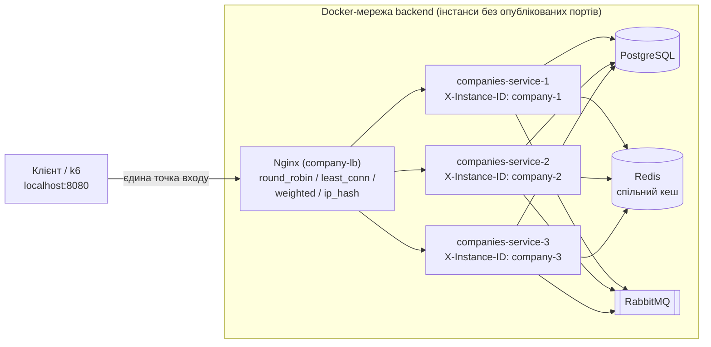

# Лабораторна робота №3. Горизонтальне масштабування та балансування навантаження

Stateless-сервіс `CompanyService` розгорнуто пулом із 3 однакових інстансів за єдиною точкою входу — Nginx.
Стан живе назовні процесу: PostgreSQL (дані), Redis (кеш), RabbitMQ (події).

## 1. Архітектура



Інкапсуляція: у `docker-compose.yml` у сервісів `companies-service-*` немає `ports`, тому зовні вони
недоступні (`http://localhost:5011` більше не працює). Єдиний вхід — `http://localhost:8080`.

## 2. Структура файлів

| Файл | Призначення |
|---|---|
| `docker-compose.yml` | 3 інстанси, nginx, змінні `LB_ALGO`, `DELAY_1..3`, `COMPANY_CPUS` |
| `nginx/nginx.conf` | Reverse proxy, таймаути, `proxy_next_upstream` (failover), лог з `upstream_addr` |
| `nginx/upstreams/*.conf` | Алгоритми: `round_robin`, `least_conn`, `weighted`, `ip_hash`, `scale_1`, `scale_2` |
| `CompanyService.API/Program.cs` | `GET /health`, штучна затримка `ARTIFICIAL_DELAY_MS` |
| `CompanyService.API/Health/DependencyHealthChecks.cs` | Перевірки PostgreSQL та Redis |
| `script/k6-load.js` | Навантажувальний тест (p95/p99, RPS, розподіл по інстансах) |
| `script/lb-distribution.sh` | Розподіл N запитів по інстансах |
| `script/lab3-failover.sh` | Автоматичний failover-тест (stop/start контейнера під потоком запитів) |

## 3. Запуск

```bat
docker compose up -d --build
curl -i http://localhost:8080/health
```

Перемикання алгоритму (Windows cmd; змінна живе в межах сесії):

```bat
set LB_ALGO=least_conn
docker compose up -d nginx
```

Скидання: `set LB_ALGO=` і знову `docker compose up -d nginx`.

Навантажувальний тест (k6 у тій самій мережі, звертається до `http://nginx`):

```bat
docker run --rm -i --network hlse-asv_backend -e VUS=50 -e DURATION=30s grafana/k6 run - < script\k6-load.js
```

## 4. `GET /health`

Повертає JSON зі станом залежностей та `instance`.

| Залежність | Збій | Статус інстанса | HTTP |
|---|---|---|---|
| PostgreSQL | недоступна | Unhealthy | 503 |
| Redis | недоступний | Degraded (працюємо напряму з БД, див. `CachingBehavior`) | 200 |

## 5. Балансування та Health Check у Nginx

- **Passive health check:** `max_fails=2 fail_timeout=10s` — після 2 невдач за 10 с вузол тимчасово виключається з пулу.
- **Failover без 5xx:** `proxy_next_upstream error timeout http_502 http_503 http_504` + `proxy_next_upstream_tries 3` —
  невдалий запит прозоро повторюється на іншому вузлі. `proxy_connect_timeout 1s` дозволяє швидко виявити мертвий вузол.
- **Active health check:** у Nginx OSS відсутній (директива `health_check` є лише в Nginx Plus). Альтернатива з активними
  перевірками `GET /health` — HAProxy (`option httpchk GET /health`).

### Порівняння алгоритмів (теорія)

| Алгоритм | Ідея | Коли доречний | Обмеження |
|---|---|---|---|
| Round Robin | По черзі | Однорідні вузли, короткі однакові запити | Не враховує поточне навантаження вузла |
| Least Connections | Вузол з найменшою кількістю активних з'єднань | Різна тривалість запитів, повільний вузол | Рахує з'єднання, а не їх «вагу» |
| Weighted RR | Пропорційно `weight` | Вузли різної потужності | Ваги задаються вручну, статично |
| IP Hash | Хеш IP клієнта → вузол | Сесійна прив'язка без cookie | За NAT/проксі всі клієнти мають один IP → весь трафік на один вузол; нерівномірно; при зміні пулу хеші перемішуються |

## 6. Експерименти

> Усі значення нижче — **результати власних вимірювань**. Заповнити після запусків (команди наведено в кожному пункті).

### 6.1. Round Robin: розподіл

```bat
docker compose up -d nginx
bash script/lb-distribution.sh http://localhost:8080/api/Companies/GetAll 300
```

| Інстанс | Запитів | Частка |
|---|---|---|
| company-1 | … | … |
| company-2 | … | … |
| company-3 | … | … |

### 6.2. Альтернативні алгоритми

```bat
set LB_ALGO=weighted
docker compose up -d nginx
bash script/lb-distribution.sh http://localhost:8080/api/Companies/GetAll 300
```

Повторити для `least_conn` та `ip_hash`.

| Алгоритм | company-1 | company-2 | company-3 | Спостереження |
|---|---|---|---|---|
| weighted (3:2:1) | … | … | … | очікуємо ≈ 50% / 33% / 17% |
| least_conn (без затримки) | … | … | … | … |
| ip_hash | … | … | … | всі запити з одного IP → один вузол |

Примітка щодо `ip_hash`: запити з хоста Windows приходять до nginx з IP шлюзу Docker, тому всі клієнти «виглядають»
як один IP. Це практична ілюстрація обмеження алгоритму.

### 6.3. Асиметричне навантаження (затримка на одному інстансі)

Додаємо затримку 500 мс на `companies-service-2`:

```bat
set DELAY_2=500
docker compose up -d companies-service-2
```

Для кожного алгоритму (`round_robin`, `least_conn`):

```bat
set LB_ALGO=round_robin
docker compose up -d nginx
docker run --rm -i --network hlse-asv_backend -e VUS=50 -e DURATION=30s grafana/k6 run - < script\k6-load.js
```

| Алгоритм | RPS | avg | p95 | p99 | company-1 | company-2 (повільний) | company-3 |
|---|---|---|---|---|---|---|---|
| round_robin | … | … | … | … | … | … | … |
| least_conn | … | … | … | … | … | … | … |

Що очікуємо: Round Robin віддає повільному вузлу ≈ 1/3 запитів незалежно від його стану, тому p99 близький до затримки
вузла, а віртуальні користувачі часто «застрягають» на ньому. Least Connections бачить, що на повільному вузлі накопичуються
відкриті з'єднання, і спрямовує більшість нових запитів на швидкі вузли — p99 та RPS мають бути кращими.
**Висновок зробити за фактичними цифрами таблиці.**

Скидання: `set DELAY_2=` і `docker compose up -d companies-service-2`.

### 6.4. Fault tolerance: зупинка інстанса

```bat
set LB_ALGO=round_robin
docker compose up -d nginx
bash script/lab3-failover.sh
```

Скрипт на 100-му запиті виконує `docker stop companies-service-2`, на 200-му — `docker start`, і підсумовує коди відповідей.

| Метрика | Значення |
|---|---|
| Всього запитів | … |
| Відповідей 5xx | … |
| Повільних запитів (retry, >0.5 с) | … |
| Запитів, обслужених company-2 після stop | … |

Очікувана поведінка: запит, що потрапив на зупинений вузол, отримує `connect error/timeout` (до 1 с), nginx повторює його на
живому вузлі (в логу `upstream=` містить дві адреси), клієнт 5xx не бачить. Після `max_fails` вузол пропускається ще `fail_timeout`.

Обмеження: після `docker start` контейнер може отримати нову IP-адресу, а nginx резолвить імена лише при старті. Якщо трафік
на відновлений вузол не повертається — `docker compose restart nginx`.

Перегляд логів балансувальника: `docker compose logs nginx --tail 50`.

### 6.5. Scale-out: 1, 2, 3 інстанси

Кожен інстанс обмежено до `COMPANY_CPUS` (за замовчуванням 1.0 CPU), щоб приріст від масштабування не «з'їдався» тим, що один
інстанс бере всі ядра хоста.

```bat
set LB_ALGO=scale_1
docker compose up -d nginx
docker run --rm -i --network hlse-asv_backend -e VUS=100 -e DURATION=30s grafana/k6 run - < script\k6-load.js
```

Повторити для `scale_2` та `round_robin` (3 інстанси). Для розрахунку навантаження на БД повторити з некешованим ендпоінтом
(наприклад, `-e TARGET_PATH=/api/Companies/GetByEmail/test@test.com`).

| Інстансів | RPS (GetAll, кеш) | p99 | RPS (БД, без кешу) | p99 |
|---|---|---|---|---|
| 1 | … | … | … | … |
| 2 | … | … | … | … |
| 3 | … | … | … | … |

### 6.6. Аналіз вузьких місць

Кандидати на наступне обмеження після масштабування compute-шару (перевіряти вимірюваннями):

1. **CPU хоста / Docker VM.** Всі контейнери, k6 і nginx ділять одні ядра, тому масштабування на одній машині
   має стелю; перевіряти `docker stats` під час тесту.
2. **Пул з'єднань PostgreSQL.** Npgsql за замовчуванням дозволяє до 100 з'єднань на процес; 3 інстанси → до 300,
   а `max_connections` у PostgreSQL за замовчуванням 100. Перевіряти: `docker exec postgres psql -U postgres -c "select count(*) from pg_stat_activity;"`.
3. **Redis** — один однопотоковий вузол; для кешованих запитів стає спільною точкою.
4. **Nginx** — один екземпляр: SPOF і потенційний ліміт CPU/мережі.

**Висновок:** … (вказати компонент, який за результатами 6.5 першим впирається в ліміт, і чим це підтверджено).
